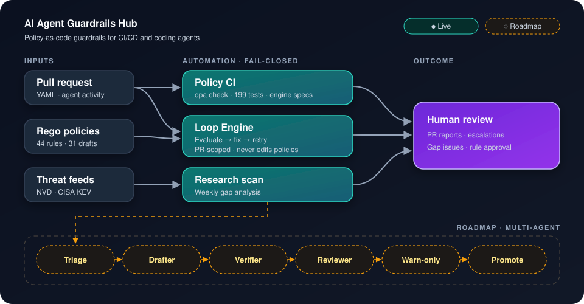

# AI Agent Guardrails Hub

**Policy-as-code guardrails for Harness CI/CD and Pi coding agents.**



## Features

- **Policy checks:** 44 OPA/Rego rules for pipelines, connectors, delegates, Bash, code, and workflow gates.
- **Auto-fix loop:** Evaluates PRs, attempts fixes, and escalates unresolved issues.
- **Threat research:** Weekly NVD and CISA KEV scans flag gaps for review.
- **Health checks:** Validate policies and agent specifications every 12 hours.

## Quick start

Requires [OPA](https://www.openpolicyagent.org/) v0.68.0.

```bash
opa test policies/opa/ policies/pi/ -v
```

> [!WARNING]
> Reference automation—not a production security boundary. Workflows can commit changes and create issues. Review all fixes and harden CI failure handling before using results as merge gates.

## Contributing

Add a rule, tests, and [remediation guidance](docs/violation-remediation.md), then open a PR.

**Docs:** [Policy guide](docs/policy-guide.md) · [Maintenance](docs/MAINTENANCE.md)
